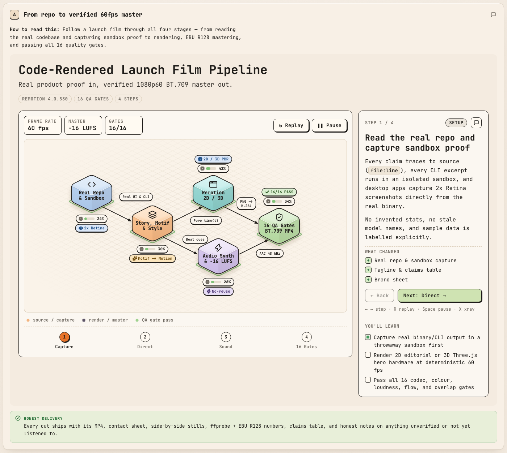
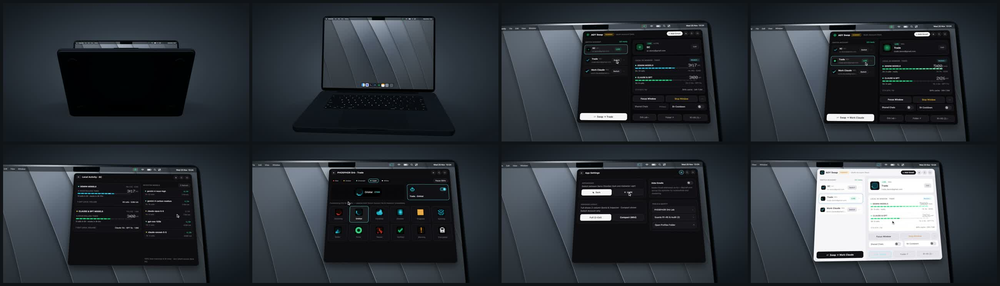

<div align="center">

<h1>product-launch-film</h1>

<p><strong>Code-rendered software launch films in Remotion — built from real product output, zero AI slop.</strong></p>

<p>
  <a href="./SKILL.md"></a>
  <a href="#16-quality-gates"></a>
  <a href="#16-quality-gates"></a>
  <a href="./references/3d-device-stage.md"></a>
  <a href="./LICENSE"></a>
</p>

<p>
  <a href="#how-it-works">Pipeline</a> ·
  <a href="#showcase">Showcase</a> ·
  <a href="#install">Install</a> ·
  <a href="#quick-start">Quick Start</a> ·
  <a href="#the-11-stage-method">Method</a> ·
  <a href="#16-quality-gates">16 Gates</a> ·
  <a href="#case-studies">Case Studies</a>
</p>

</div>

---

An agent skill (`SKILL.md`) and pinned Remotion starter for producing **20–75 s, 1920×1080 @ 60 fps launch, promo, demo, and seamless 3D hero-device films** directly from a real codebase. Built for agents that read Agent Skills (`Claude Code`, `Codex`, `Cursor`, `Antigravity`, and others).

| Pillar | What the skill enforces |
| :--- | :--- |
| **Real Product Proof** | Every claim traces to `file:line`; CLI runs inside a throwaway sandbox; desktop apps use **2× Retina real-binary captures** instead of drifting hand-redrawn mockups. |
| **2D Editorial & 3D Studio** | Light editorial motif-to-motion for narrative launch cuts (40–70 s), or a photorealistic **Three.js hero hardware stage** for single-take macro loops (18–30 s). |
| **Fresh Sound & -16 LUFS** | Per-film instrument palette with strict no-reuse checks, zero-dep Node (`make-audio.mjs`) or Python synth + tactile SFX, optional ElevenLabs VO + STT check, EBU R128 mastering. |
| **16 Hard QA Gates** | Automated verification of H.264 High, 60 fps, explicit `BT.709` color tags, loudness/true-peak, brand pixel survival, optical flow holds, layout overlaps, and click-frame diffs. |

---

## How it works

<picture>
  <source media="(prefers-color-scheme: dark)" srcset="./docs/assets/pipeline-isokit-dark.png">
  <source media="(prefers-color-scheme: light)" srcset="./docs/assets/pipeline-isokit-light.png">
  
</picture>

<sub>Visual built with <a href="https://github.com/KJ-AIML/clarify">Clarify</a> (<code>isokit</code>) from <a href="./docs/pipeline-tour.md"><code>docs/pipeline-tour.md</code></a>.</sub>

---

## Showcase

Real cuts produced and iterated with this skill — including the feedback loops that hardened `SKILL.md` v2.1:

### 1. AGY Swap — 3D Hero-Device Single-Take Loop (`21.0 s · 1080p60 · No-VO · Seamless Loop`)



- **Product:** [`KJ-AIML/agy-swap`](https://github.com/KJ-AIML/agy-swap) (native macOS GPUI & CLI account switcher).
- **Stage:** Direct Three.js `<canvas>` inside Remotion (`useCurrentFrame()` synchronous render), bead-blasted matte Space Black MacBook Pro 16" (79 backlit keys, Inverted-T arrows, Touch ID ring, micro-dot speaker grilles, side ports), composited with **100% real 2× Retina GPUI sandbox captures**.
- **Audio & QA:** Zero-dependency Node.js `Float64Array` marimba + mechanical click SFX with bus compression, mastered to `-16.09 LUFS` / `-2.1 dBTP` / `BT.709`, verified via Click-Frame Audit and side-by-side Real-App Diff.
- **Playbook & Postmortem:** [`references/3d-device-stage.md`](./references/3d-device-stage.md) · [`references/case-studies.md`](./references/case-studies.md#agy-swap-v1--v3-zero-friction-account-switching--3d-hero-device-single-take-loop)

### 2. Heli-Harness — Light Editorial Launch Film (`57 s · 1080p60 · Conversational VO`)

- **Watch:** [Heli-Harness launch film (MP4)](https://github.com/KJ-AIML/heli-harness/releases/download/v0.10.4/heli-harness-launch.mp4)
- **Stage:** Light "clear air" editorial theme, Schibsted Grotesk + JetBrains Mono, 2 px thread motif, real sandbox CLI output, ElevenLabs `eleven_v4` conversational narration verified with STT.
- **Worked Artifacts:** [`references/heli/concept-v2.md`](./references/heli/concept-v2.md) · [`references/heli/`](./references/heli/)

### 3. Connectra — Multi-Cut Editorial & Pure-Geometry Fleet (`v1 → v4`)

- **Worked Artifacts:** [`references/connectra/`](./references/connectra/) — concept evolution (`v1 → v4`), narration scripts, WCAG AA contrast tokens, and pure-geometry radial overlap checker (`check-fleet.ts`).

---

## Install

### Recommended (Agent Skills CLI)

```bash
npx skills add KJ-AIML/product-launch-film
```

<details>
<summary><strong>Manual install (Claude Code, Codex, Cursor, Antigravity, or per-repo)</strong></summary>

Clone the repository and link or copy it so `SKILL.md` lives at `<skills-dir>/product-launch-film/SKILL.md`:

```bash
git clone https://github.com/KJ-AIML/product-launch-film.git ~/src/product-launch-film

# Vendor-neutral Agent Skills directory (Codex, Cursor, Antigravity, etc.)
mkdir -p ~/.agents/skills && cp -R ~/src/product-launch-film ~/.agents/skills/product-launch-film

# Claude Code (user-level)
mkdir -p ~/.claude/skills && ln -s ~/src/product-launch-film ~/.claude/skills/product-launch-film

# Per-project (committed with your repo)
mkdir -p .agents/skills && cp -R ~/src/product-launch-film .agents/skills/product-launch-film
```

> Some tools ignore symlinks — if the skill does not appear after restarting your agent session, copy the directory instead of symlinking.

</details>

---

## Quick start

Once installed, ask your agent directly inside any software repo:

- *"Make a 50-second editorial launch film for this repo."*
- *"Build a 21-second 3D MacBook Pro single-take macro demo for this macOS app."*

Or bootstrap manually from the pinned Remotion `4.0.530` starter:

```bash
cp -R ~/src/product-launch-film/templates/remotion-starter ./launch-film
cd launch-film
npm install

npm run studio        # interactive Remotion preview
npm run check         # TypeScript + layout geometry + WCAG AA contrast
npm run audio:node    # zero-dep Node stereo WAV starter (no Python required)
npm run stills        # full-res named key frames
npm run audit         # dense half-res frames for contact-sheet review
npm run render        # PNG frames -> H.264 High yuv420p + BT.709 + -16 LUFS AAC
```

**Requirements:** Node ≥ `22.18` and `ffmpeg` (full build for mastering/VO cleanup). Optional: Python 3 + `numpy` if using `scripts/make_audio.py`, and `ELEVENLABS_API_KEY` (kept strictly in env, never committed) for voice-over + STT pronunciation verification.

---

## The 11-stage method

Every film follows the sequence in [`SKILL.md`](./SKILL.md), with zero skipped honesty or craft steps:

| Stage | Focus | Key artifact / rule |
| :--- | :--- | :--- |
| **1. Understand** | Read real source, `--help`, UI tokens, live model/feature catalogues | Pin commit/date, features-shown table, brand sheet, sandbox freshness check |
| **2. Story first** | Lock one tagline and 6–9 beats (or single-take macro arc) as data | `script.json` / `scenes.json`, pain ≤ 25% runtime, readable in 3 s muted |
| **3. Capture** | Run CLI/app in throwaway sandbox; **2× Retina binary captures** for desktop UI | Verbatim strings, labelled sample data, zero unbuilt features sold as shipped |
| **4. Visual direction** | Brand-derived light palette (or calibrated 3D dark studio cyclorama), Krehel UI polish | WCAG AA (`4.5:1`), ligatures off in code, zero slop tells (no glow/badge piles) |
| **5. Style direction** | Draft 2–3 genuinely distinct directions before building | Motif-to-motion verbs, reference-clip study, or [`3d-device-stage.md`](./references/3d-device-stage.md) |
| **6. Motion** | Pure `f(t)` timing, seeded PRNG, continuous velocity, 8-sample 180° motion blur | Fritsch-Carlson Hermite tracks, log-space zoom, closed-form springs, BPM sync |
| **7. Build** | Modular Remotion `4.0.530` scenes; direct synchronous Three.js `<canvas>` for 3D | PNG frame sequence → single H.264 High encode; new cut = new composition |
| **8. Sound** | Fresh timbre per film (no-reuse check), zero-dep Node or Python synth, tactile SFX | Per-bus envelope compression (`<10%` limiter), optional VO + STT check, `-16 LUFS` |
| **9. Quality gates** | Run all 16 hard gates on the final MP4 + contrast & visual contact-sheet audit | Record results in `docs/qa.md`; Click-Frame Audit + Real-App Diff for 3D `<canvas>` |
| **10. Bilingual / TH** | Single scene timeline per language with grapheme typing & tone-mark clip safety | Retime per language (~6–8% longer for Thai), separate claims tables |
| **11. Review & ship** | Critique stills & contact sheet, iterate at least once before delivery | Full delivery pack (`MP4`, contact sheet, stills, QA table, `CREDITS.md`, `STATUS.md`) |

---

## 16 quality gates

Hard gates run against the finished MP4 (`docs/qa.md`) — every row must `PASS` (or document a concrete `REVIEW` rationale):

| Category | Automated gates |
| :--- | :--- |
| **Codec & Color (1–5, 10–11)** | `h264` High `1920×1080`, `60/1` fps, `yuv420p` TV range, explicit `bt709` matrix + primaries + transfer bitstream tags, exact frame count, brand & ground pixel survival (`±4` / `±6` RGB). |
| **Audio & Loudness (6–9)** | AAC `48 kHz` stereo, `-16 ±0.5 LUFS` integrated, true peak `≤ -2.0 dBTP`, loudness range `3–12 LU`, master limiter active on `< 10%` of samples. |
| **Motion & Flow (12–14)** | DIS optical flow longest hold `≤ 0.6 s`, held-time share `≤ 6%`, exact duplicate frames `≤ 0.2%`. |
| **Layout & Fidelity (15–16)** | Zero DOM overlaps mid-animation and safe-area compliance (for 3D WebGL `<canvas>` films: **Click-Frame Audit** at `t-1f, t, t+1f` + **Side-by-Side Real-App Frame Diff**). |

---

## Case studies

Read [`references/case-studies.md`](./references/case-studies.md) for the exact feedback rounds that built this method:

- **Connectra (`v1 → v4`):** Replacing generic dark UI with light editorial paper, measured WCAG AA contrast, pure-geometry fleet layout, and conversational `eleven_v4` VO.
- **Heli-Harness (`v1 → v2`):** Pivoting from a dark governance tour to a value-first daily-pain story (*"Switch tools. Keep the thread."*), keeping praised voice/pacing verbatim, catching `"Heli" → "Healy"` via STT.
- **AGY Swap (`v1 → v3`):** Fixing chrome-looking Space Black PBR (`metalness: 0.38, roughness: 0.56`), upgrading hand-redrawn Canvas UI to 2× Retina real-binary GPUI captures, auditing stale sandbox model names, and shipping a 21 s seamless 3D single-take loop.

---

## Repository structure

```text
product-launch-film/
├── SKILL.md                             11-stage production method (v2.1)
├── docs/
│   ├── pipeline-tour.md                 Clarify isokit source for the pipeline diagram
│   └── assets/                          Adaptive light/dark pipeline PNGs + 3D showcase sheet
├── references/
│   ├── 3d-device-stage.md               Three.js 3D hero-device PBR, MacBook, capture & audit guide
│   ├── checklist.md                     Anti-slop, 3D hardware, audio & delivery checklist
│   ├── case-studies.md                  Connectra v1→v4, Heli-Harness v1→v2, AGY Swap v1→v3
│   ├── sound-research.md                Commercial-safe music/SFX sources, licences & techniques
│   ├── CHANGES-v2.md                    Changelog across v1 → v2 → v2.1
│   ├── heli/                            Worked concept docs, scripts, copy & layout checker
│   └── connectra/                       Worked concept notes, scripts & fleet overlap checker
└── templates/remotion-starter/          Pinned Remotion 4.0.530 project + Node/Python audio + master
```

---

## Design craft & licences

- **UI polish rules:** Concentric radii, tinted shadow rings over borders, one primary action per panel, spacing over dividers, tabular numbers, and `text-wrap: balance` draw from [Jakub Krehel's UI skills](https://jakub.kr/skills) ([`jakubkrehel/skills`](https://github.com/jakubkrehel/skills) — not vendored here; install directly from source).
- **Licences:** This repository is [MIT](./LICENSE). Brought-in tools keep their own terms: [Remotion](https://remotion.dev/license) is free for individuals and companies of up to 3 people; free-tier ElevenLabs voices require attribution and are non-commercial; Google Fonts are mostly SIL OFL. Worked assets under `references/heli/` and `references/connectra/` are included strictly as method examples.
